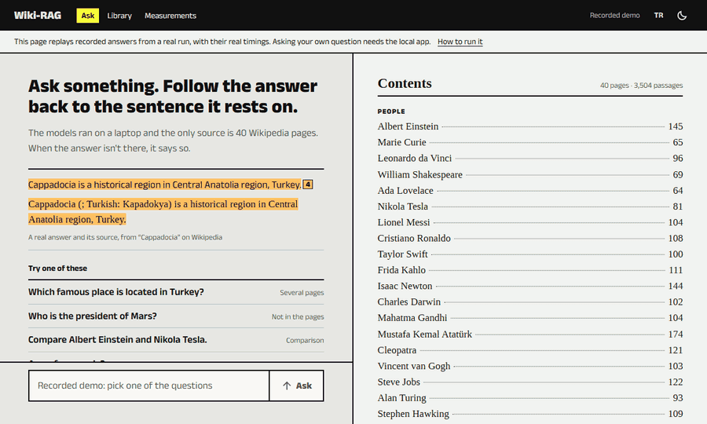
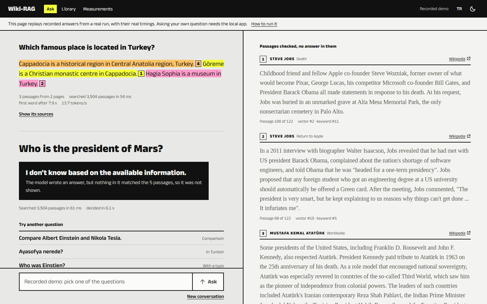
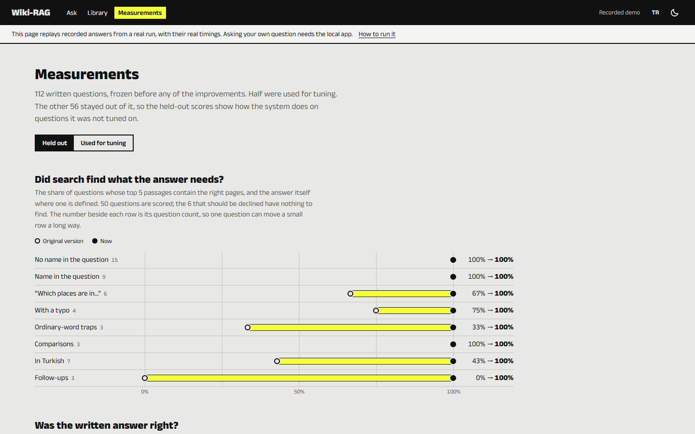
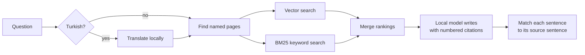

# Wiki-RAG

Ask questions about Wikipedia pages using models that run on your own machine. Each sentence of the answer is highlighted together with the source sentence it rests on, and when the pages don't contain the answer, it says so instead of guessing.

**[Try the recorded demo](https://itu-itis23-baranr22.github.io/wiki-rag/)** (no install, replays real answers) · [Quick start](#quick-start) · [Results](#results) · [How it works](#how-it-works)



## What it does

- **Checkable answers.** Every citation is a colored stroke across the exact source sentence. Hover over one and only that pair stays inked. Sentences the model didn't cite are matched by comparing text and marked differently, and a sentence with no support is labelled as having no source.
- **It declines when it should.** Questions the pages can't answer get a plain refusal, and the passages it checked stay visible with nothing highlighted.
- **Turkish and English.** Ask in either language and the answer follows. Turkish questions are translated locally for the search, and the interface itself comes in both.
- **Follow-ups, typos and trap words.** "Where was she born?" continues from the previous answer. "Einstien" finds Einstein. "What jobs did Marie Curie have?" doesn't pull in Steve Jobs.
- **Your own pages.** Add any Wikipedia page from the Library, and it's searchable within a minute.
- **Nothing leaves your machine.** Questions, answers and search all stay local, and telemetry is off. The only network use is downloading Wikipedia pages when you build or extend the index.



## Results

112 questions were written and frozen before anything changed. Half were used for tuning. This table shows the other half, which played no part in it, on the original version and on this one.

| Question type | Questions | Search, before | Search, now | Answer, before | Answer, now |
|---|---:|---:|---:|---:|---:|
| No name in the question | 15 | 100% | 100% | 87% | 100% |
| Name in the question | 9 | 100% | 100% | 100% | 100% |
| "Which places are in…" | 6 | 67% | 100% | 50% | 100% |
| With a typo | 4 | 75% | 100% | 50% | 100% |
| Ordinary-word traps | 3 | 33% | 100% | 100% | 100% |
| Comparisons | 3 | 100% | 100% | 100% | 100% |
| In Turkish | 7 | 43% | 100% | 71% | 100% |
| Follow-ups | 3 | 0% | 100% | 33% | 100% |
| Should decline | 6 | n/a | n/a | 100% | **83%** |
| **All searches** | **50** | **76%** | **100%** | | |

*Search* means the top 5 passages contain the right pages, and the fact itself where one is defined. *Answer* means the answer contains the expected fact, or declines when it should.

Every answer now cites a passage (none did before), and every number in an answer appears in its passages (86% before). On the same laptop, with only a CPU:

| Median of 12 questions | Before | Now |
|---|---:|---:|
| Search | 2.2 s | 44 ms |
| Until the first word | 10.8 s | 6.0 s |
| Full answer | 12.4 s | 8.7 s |

**How far to trust these numbers:**

- **One score got worse.** Declining fell from 100% to 83%, because asking for citations makes the small model more willing to answer. Asked how to sort a list in Python, it wrote something about Monty Python.
- **The 100%s say the questions are easy, not that the system is perfect.** They were written for this project, not taken from real use, and pattern scoring only confirms an expected fact appears. So an AI assistant (Claude) also read all 50 held-out answers to answerable questions, one by one. That found one wrong fact the patterns accepted (Einstein winning two Nobel Prizes). No person has repeated that check; the record is in [`eval/results/manual-review.json`](eval/results/manual-review.json).
- **Written Turkish is the weakest point.** Of the 8 answers written in Turkish, 4 mix in English words and 1 is confused. Search finds the right passages, but this small model struggles to write about them in Turkish.

What each change contributed, added one at a time on the tuning questions:

| Change | Search success | Right page ranked first |
|---|---:|---:|
| Original version | 78% | 76% |
| New chunking, and a router for typos, trap words and follow-ups | 86% | 86% |
| The task prefixes the embedding model expects | 90% | 84% |
| Keyword search merged with vector search | 94% | 86% |
| At most two passages per page when no page is named | 96% | 86% |
| Firm cues such as "place" restrict the page type | 96% | 90% |
| Turkish questions searched through a local translation | 100% | 96% |

The app's Measurements page shows all of this, including the tuning set.



## Quick start

You need Python 3.10 or newer and [Ollama](https://ollama.com).

```bash
git clone https://github.com/itu-itis23-baranr22/wiki-rag.git
cd wiki-rag
python -m venv .venv
source .venv/bin/activate        # Windows: .venv\Scripts\activate
pip install -r requirements.txt

ollama pull nomic-embed-text     # embeddings, about 270 MB
ollama pull llama3.2:3b          # answers, about 2 GB

python -m src.ingest             # downloads and indexes 40 pages, a few minutes on a CPU
python app.py                    # opens http://127.0.0.1:8000
```

Prefer a terminal? `python cli.py` has the same answers, with `/sources`, `/reset` and `/quit`.

If you stop `python -m src.ingest` partway, run it again. It keeps finished pages and skips anything that hasn't changed.

**Short on memory?** Ollama's model server can hold up to 8 GB of cached prompts. On a 16 GB laptop that was enough for the system to run low. Starting Ollama with a limit took it from 8.9 GB to 2.8 GB on Ollama 0.40:

```bash
LLAMA_ARG_CACHE_RAM=256 ollama serve          # PowerShell: $env:LLAMA_ARG_CACHE_RAM=256; ollama serve
```

### Settings

| Environment variable | Default | Meaning |
|---|---|---|
| `WIKI_RAG_GEN_MODEL` | `llama3.2:3b` | Model that writes answers |
| `WIKI_RAG_EMBED_MODEL` | `nomic-embed-text` | Embedding model. Changing it requires `python -m src.ingest --reset` |
| `WIKI_RAG_OLLAMA_HOST` | `http://127.0.0.1:11434` | Ollama address |
| `WIKI_RAG_DATA_DIR` | `./data` | Where pages and the index are stored |

The default page list, chunk sizes and search settings are in [`src/config.py`](src/config.py).

## How it works



| Stage | File | What it does |
|---|---|---|
| Fetch | [`src/wiki.py`](src/wiki.py) | Downloads pages, drops references and similar sections, caches the result |
| Chunk | [`src/chunker.py`](src/chunker.py) | Splits each section on sentence boundaries, with whole-sentence overlap |
| Index | [`src/ingest.py`](src/ingest.py), [`src/vector_store.py`](src/vector_store.py) | Embeds with the page title for context, and skips unchanged pages |
| Route | [`src/router.py`](src/router.py) | Recognises names, typos, follow-ups and trap words with plain rules, in under a millisecond |
| Search | [`src/retriever.py`](src/retriever.py), [`src/lexical.py`](src/lexical.py) | Vector search plus BM25, merged by reciprocal rank fusion, capped per page |
| Generate | [`src/generator.py`](src/generator.py) | Asks the model to use only the passages and to cite them |
| Attribute | [`src/attribution.py`](src/attribution.py) | Finds the source sentence behind each answer sentence |
| Serve | [`src/server.py`](src/server.py), [`web/`](web/) | FastAPI streaming to a hand-written interface with no external requests |

No RAG framework is involved, so each stage is short enough to read in one sitting.

## What the measurements changed

Some of this project's most useful results were assumptions that turned out to be wrong, and ideas that weren't worth building.

- **`localhost` cost two seconds per request on Windows.** Using `127.0.0.1` and a shared session took one embedding call from 2,080 ms to about 30 ms. That accounts for most of the speedup above. The likely cause is Windows trying IPv6 first, though only the effect was measured, not the cause.
- **Vector search wasn't the main reason country names were missed.** That was the first assumption, and it was mostly wrong. The original code left out the task prefixes `nomic-embed-text` expects. Adding them alone took "which places are in…" questions from 67% to 100% on the tuning set. Keyword search still helped overall, most of all on Turkish questions.
- **Batching embeddings didn't help.** Once the `localhost` delay was gone, batches took 86 ms per chunk against 89 ms one at a time on a CPU.
- **Two refusal shortcuts failed on the data.** A distance threshold and a check for question words in the passages both overlap too much between valid and unanswerable questions, so either would reject good questions. What did work: an answer with no sentence traceable to any passage is withheld and reported as such.
- **Reordering the prompt made things worse.** Putting the refusal rule first added a false refusal and a wrong birth year without fixing any refusal, so it was reverted.
- **A prompt-truncation scare didn't hold up.** Measured prompts stay well inside the model's context window.

## Evaluate it yourself

```bash
python -m eval.run_eval --split dev               # search only, about a minute
python -m eval.run_eval --split test --answers    # with answers, about 15 minutes on a CPU
python -m eval.publish                            # updates the Measurements page
```

A long run saves after each question, so `--resume` continues one that was interrupted. The questions are in [`eval/golden.jsonl`](eval/golden.jsonl), and results for each question are in [`eval/results/`](eval/results/).

## Tests

```bash
pip install -r requirements-dev.txt
pytest
ruff check .
```

The tests use a real Chroma index with a fake model client, so they need neither Ollama nor network access. CI runs them on Linux and Windows.

## Limitations

- **A small model makes mistakes.** `llama3.2:3b` on a CPU can write a wrong statement even with the right passages in front of it. Highlights make a wrong statement easier to catch, but don't prevent one. A larger model is one environment variable away.
- **Refusals aren't reliable enough.** One in six unanswerable questions still gets an answer, as the results above show.
- **Highlighting is weaker for Turkish.** Turkish answers share only names and numbers with English sources, so the sentence they highlight is less precise.
- **Single-user by design.** See [`recommendation.md`](recommendation.md) for what a multi-user deployment would change.

## Project documents

- [`product_prd.md`](product_prd.md): requirements and design rationale
- [`recommendation.md`](recommendation.md): what would change for production
- [`DESIGN.md`](DESIGN.md): the interface's design system

This started as a course project (ITU BLG483E) and was later rebuilt around measured quality.

## Credits and license

Code is under the [MIT License](LICENSE). Page text comes from [Wikipedia](https://en.wikipedia.org/) and is available under [CC BY-SA 4.0](https://creativecommons.org/licenses/by-sa/4.0/). It is downloaded to your machine; the only excerpts in this repository are the passages and answers in the recorded demo and evaluation results, and the app links each passage to its page. Fonts are [Anek Latin](https://github.com/EkType/Anek) and [Tinos](https://github.com/googlefonts/tinos), both under the SIL Open Font License.
